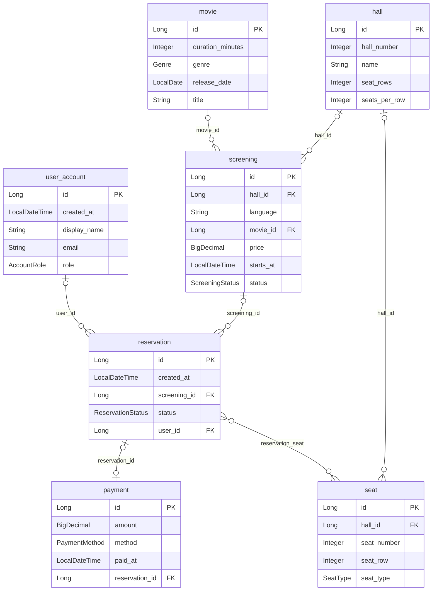

# Schemat bazy danych

Plik generują reguły projektu (panel Maven → Lifecycle → verify). Nie edytujcie go ręcznie.

Tabele: 8 (w tym tabele łączące @ManyToMany: reservation_seat) · kolumny: 37 · relacje: 5 × @ManyToOne, 1 × @OneToMany, 1 × @OneToOne, 1 × @ManyToMany

| Tabela | Encja | Kolumny | Klucze obce |
|---|---|---|---|
| hall | Hall | 5 | — |
| movie | Movie | 5 | — |
| payment | Payment | 5 | reservation_id |
| reservation | Reservation | 5 | screening_id, user_id |
| screening | Screening | 7 | hall_id, movie_id |
| seat | Seat | 5 | hall_id |
| user_account | UserAccount | 5 | — |

